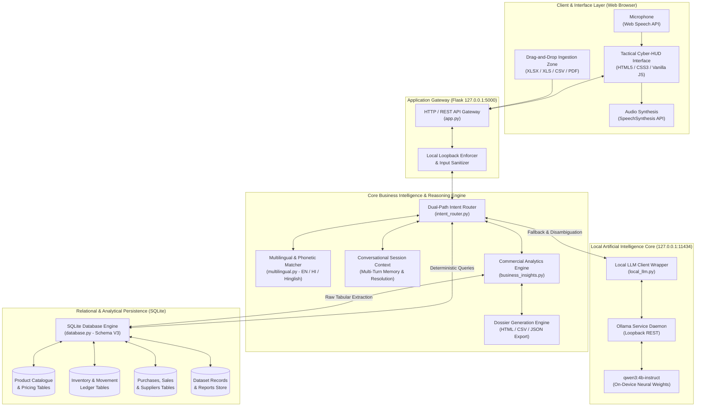
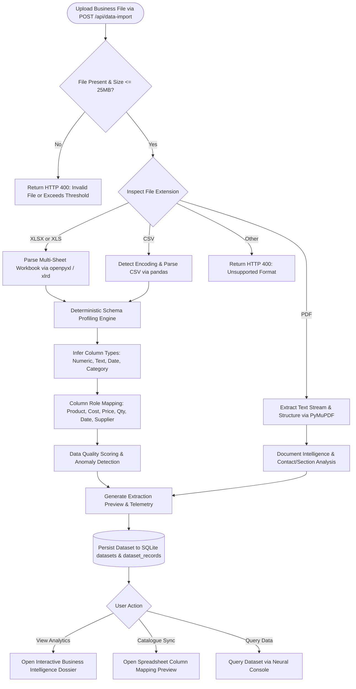
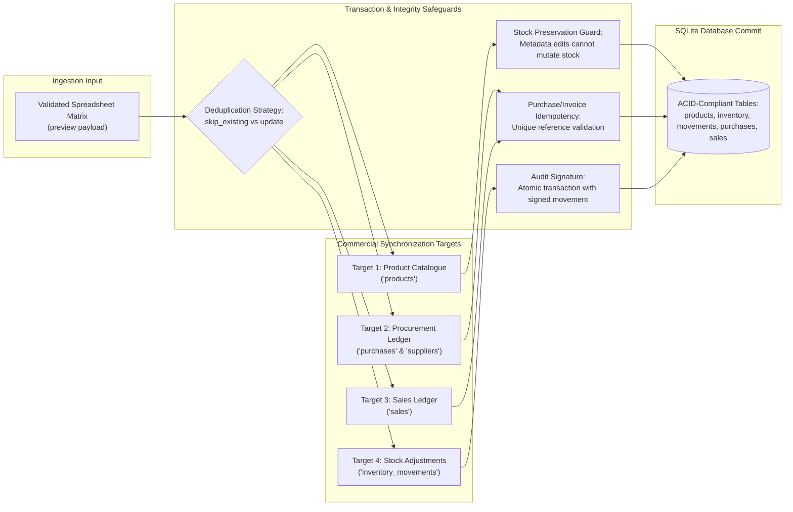
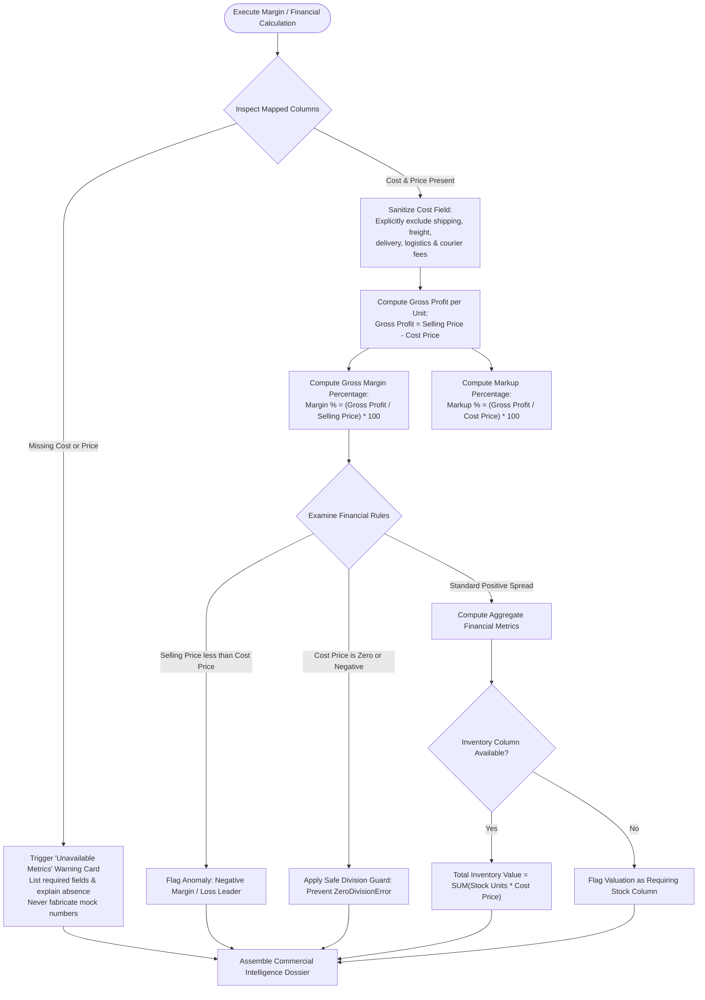
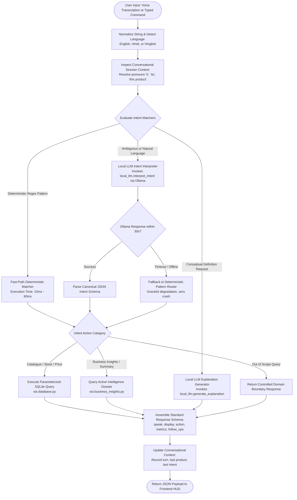
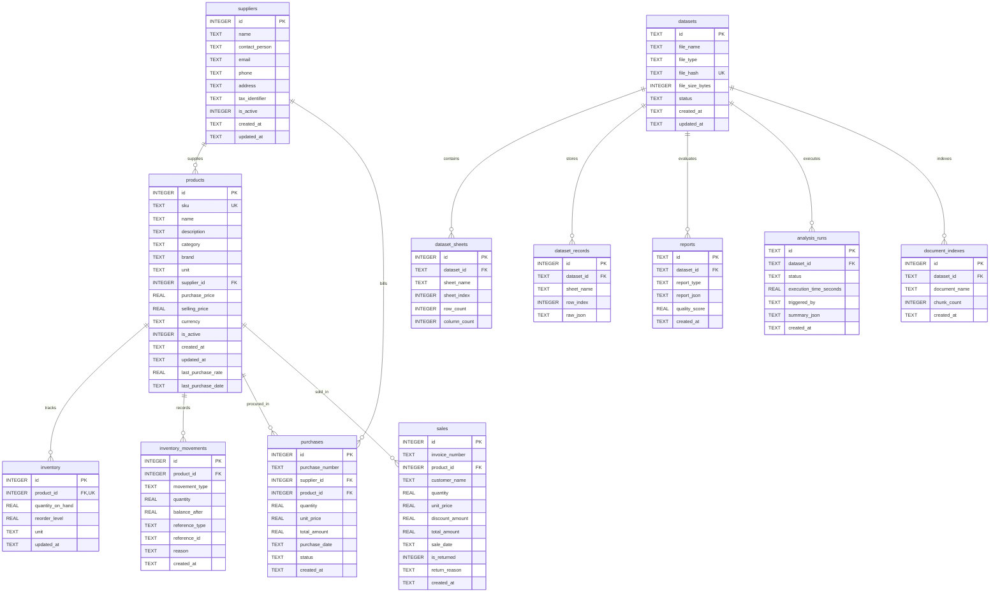
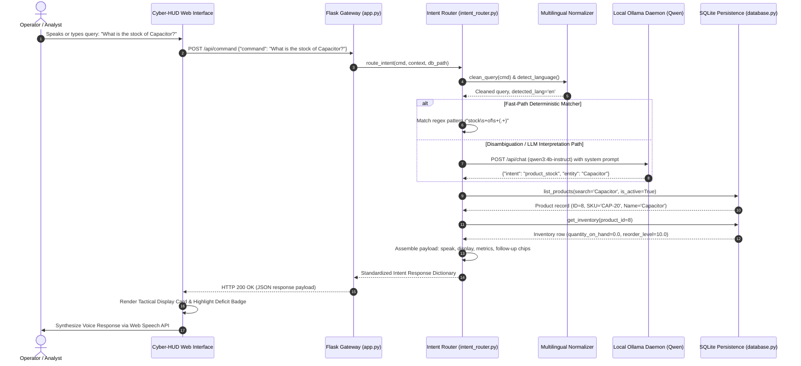
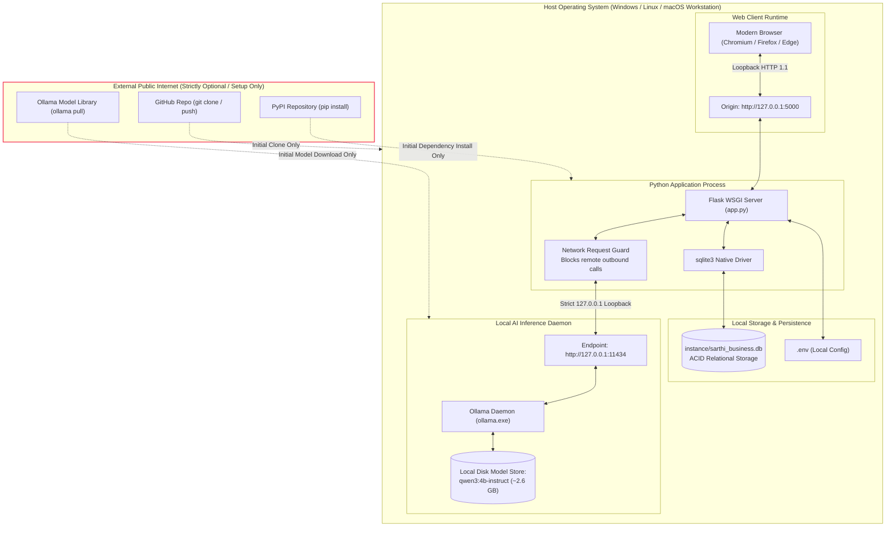

# SARTHI — AI-Powered Business Intelligence Assistant

<p align="center">
  
</p>

<p align="center">
  <strong>Enterprise-Grade, Privacy-First Commercial Intelligence & Autonomous Inventory Command</strong><br>
  <em>100% Localhost Execution &bull; Zero Cloud API Subscriptions &bull; Deterministic Financial Arithmetic &bull; Local Qwen LLM Integration</em>
</p>

<p align="center">
  <a href="https://www.python.org/downloads/"></a>
  <a href="https://flask.palletsprojects.com/"></a>
  <a href="https://www.sqlite.org/"></a>
  <a href="https://ollama.com/"></a>
  <a href="https://github.com/QwenLM/Qwen"></a>
  <a href="https://developer.mozilla.org/en-US/docs/Web/JavaScript"></a>
  <a href="https://opensource.org/licenses/MIT"></a>
  <a href="#18-testing--quality-assurance"></a>
</p>

---

## Table of Contents

1. [Executive Overview](#1-executive-overview)
2. [Problem Statement & Core Value Proposition](#2-problem-statement--core-value-proposition)
3. [Key Capabilities & Feature Matrix](#3-key-capabilities--feature-matrix)
4. [Technology Stack](#4-technology-stack)
5. [System Architecture](#5-system-architecture)
6. [Data Ingestion Pipeline](#6-data-ingestion-pipeline)
7. [Business Data Synchronization Targets](#7-business-data-synchronization-targets)
8. [Financial Intelligence & Margin Engine](#8-financial-intelligence--margin-engine)
9. [Conversational AI Query Lifecycle](#9-conversational-ai-query-lifecycle)
10. [Relational Database Schema (ERD)](#10-relational-database-schema-erd)
11. [Request & Response Sequence Flow](#11-request--response-sequence-flow)
12. [Local Deployment & Privacy Architecture](#12-local-deployment--privacy-architecture)
13. [Installation & Setup Guide](#13-installation--setup-guide)
14. [Local AI Model Setup (Ollama)](#14-local-ai-model-setup-ollama)
15. [Configuration Reference](#15-configuration-reference)
16. [Verified REST API Reference](#16-verified-rest-api-reference)
17. [Conversational Query Handbook](#17-conversational-query-handbook)
18. [Testing & Quality Assurance](#18-testing--quality-assurance)
19. [Project Directory Structure](#19-project-directory-structure)
20. [Implementation Status & Roadmap](#20-implementation-status--roadmap)
21. [Security & Privacy Blueprint](#21-security--privacy-blueprint)
22. [Author Profile & Engineering Portfolio](#22-author-profile--engineering-portfolio)
23. [License & Intellectual Property](#23-license--intellectual-property)

---

## 1. Executive Overview

**SARTHI** is an autonomous, on-premise business intelligence command center and inventory analytics platform. Engineered specifically for small-to-medium enterprises (SMEs), supply chain operators, and financial analysts, SARTHI eliminates cloud AI subscription overhead and protects sensitive corporate data through **100% offline, local loopback processing**.

SARTHI bridges the gap between unstructured business files (spreadsheets, procurement invoices, PDF dossiers) and deterministic relational persistence. By pairing a local Large Language Model (**Ollama** orchestrating `qwen3:4b-instruct`) with a high-precision deterministic financial calculation engine, SARTHI guarantees **zero numerical hallucinations**: natural language queries are parsed into structured intent parameters, while all mathematical operations and aggregations execute strictly in SQLite and Python arithmetic modules.

---

## 2. Problem Statement & Core Value Proposition

### The Problem
* **Confidentiality Vulnerabilities**: Mainstream generative AI platforms mandate uploading proprietary financial reports, vendor costs, customer records, and inventory ledgers to third-party cloud infrastructure.
* **Prohibitive SaaS & API Tolls**: Token-based commercial LLM APIs introduce unpredictable operational expenses that scale unfavorably with large document ingestion.
* **Generative Mathematical Hallucination**: Autoregressive neural networks inherently struggle with strict arithmetic, frequently inventing profit margins, miscalculating sums, or quoting inaccurate catalogue pricing.
* **Operational Tool Fragmentation**: Commercial organizations struggle with siloed tools—using disparate systems for spreadsheet viewing, inventory tracking, purchase ordering, and conversational querying.

### The SARTHI Solution
1. **Total Data Sovereignty**: All spreadsheet parsing, document vectorization, database storage, and AI reasoning execute on `127.0.0.1`. No corporate data ever traverses the public internet.
2. **Zero Recurring API Expenses**: Operates completely with local, open-weights models (`qwen3:4b-instruct`) without monthly token limits or third-party API dependencies.
3. **Deterministic Business Math**: Large language models never perform accounting arithmetic. The AI serves exclusively as an intent extractor; calculations execute via deterministic formulas and ACID-compliant SQL queries.
4. **Unified Cyber-HUD Architecture**: A high-density visual dashboard integrating natural voice synthesis, real-time hardware telemetry, interactive data quality meters, and automated multi-format reporting.

---

## 3. Key Capabilities & Feature Matrix

| Module | Purpose | Data Source | Primary Features | Status |
|---|---|---|---|---|
| **Data Ingestion** | Multi-format spreadsheet & PDF ingestion | Excel (`.xlsx`, `.xls`), CSV, PDF | Schema profiling, anomaly auditing, role mapping | **Implemented** |
| **Product Catalogue** | Master product data management | SQLite `products` table | SKU tracking, price management, permitted field patch | **Implemented** |
| **Inventory Ledger** | Real-time physical stock control | SQLite `inventory` & `inventory_movements` | Opening balance, receipts, sales, physical adjustments | **Implemented** |
| **Procurement** | Supplier tracking & purchase history | SQLite `purchases` & `suppliers` | Vendor spend, purchase orders, last purchase rates | **Implemented** |
| **Sales Analytics** | Commercial transaction ledger | SQLite `sales` table | Order dates, volume, returns/reversals handling | **Implemented** |
| **Business Insights** | Statistical analysis & data profiling | Active datasets & historical runs | Quality score, Pearson correlation, margin ranking | **Implemented** |
| **Neural Console** | Natural-language query interface | Local Ollama (`qwen3:4b-instruct`) | English, Hindi, Hinglish, contextual multi-turn | **Implemented** |
| **Dossier Exporter** | Executive document distribution | Active analytical state | Standalone HTML HUD, clean CSV, structured JSON | **Implemented** |
| **Voice Engine** | Hands-free audio command & speech | Browser Web Speech API | Dual-mode voice & typed command parity | **Implemented** |

---

## 4. Technology Stack

### Backend Infrastructure
* **Runtime**: Python 3.10+ (tested through 3.12)
* **Application Framework**: Flask 2.3+ / Werkzeug WSGI
* **Relational Persistence**: SQLite 3 with WAL (Write-Ahead Logging), Foreign Key enforcement, and atomic transactions
* **Data Science & Extraction**: pandas, NumPy, openpyxl, xlrd, PyMuPDF (`fitz`)

### Local Artificial Intelligence
* **Inference Runtime**: Ollama Daemon (REST loopback bound to `127.0.0.1:11434`)
* **Default Neural Architecture**: `qwen3:4b-instruct` (4-Billion parameter instruction-tuned multilingual LLM)
* **Routing Strategy**: Hybrid intent routing with deterministic regex fast-paths and fallback protection

### Frontend & Cyber-HUD
* **Core Technologies**: Semantic HTML5, Vanilla ES6+ JavaScript, CSS3 Design Tokens
* **Aesthetic System**: Dark cyan HUD theme, glassmorphism, responsive modular card grid
* **Visualizations**: Lightweight procedural vector SVG charts (horizontal margin bars, revenue timelines, circular data quality gauges)
* **Voice Processing**: W3C Web Speech Recognition & SpeechSynthesis APIs

---

## 5. System Architecture

The following diagram illustrates the complete SARTHI architectural ecosystem, tracing the operational boundary between the user client, local application gateway, business logic modules, local neural runtime, and relational persistence.



---

## 6. Data Ingestion Pipeline

SARTHI incorporates a deterministic file parsing and profiling pipeline that converts heterogeneous commercial files into structured datasets while guarding against invalid encodings and oversized streams.



---

## 7. Business Data Synchronization Targets

When transitioning extracted spreadsheet rows into live operational ledgers, SARTHI enforces four dedicated synchronization paths with strict duplicate prevention and inventory balance protection.



---

## 8. Financial Intelligence & Margin Engine

The financial calculation engine adheres to formal commercial accounting standards. It strictly isolates Cost of Goods Sold (COGS) from extraneous operating expenses and flags missing values rather than synthesizing mock numbers.



---

## 9. Conversational AI Query Lifecycle

SARTHI processes voice and typed queries through a multi-stage intent resolution pipeline featuring language normalization, conversational session memory, and deterministic database retrieval.



---

## 10. Relational Database Schema (ERD)

The SQLite persistence model operates under **Schema Migration V3**, providing foreign key integrity, cascade guarantees, and audit immutability.



---

## 11. Request & Response Sequence Flow

The following sequence diagram outlines the chronological flow of a natural language business query across the application boundaries.



---

## 12. Local Deployment & Privacy Architecture

SARTHI is architecturally decoupled from cloud infrastructure. The local host machine maintains strict loopback boundaries.



---

## 13. Installation & Setup Guide

### 1. Prerequisites
* **Operating System**: Windows 10/11 (64-bit), Ubuntu 20.04+, or macOS 12+
* **Python Runtime**: Python 3.10, 3.11, or 3.12 (Verify with `python --version`)
* **Memory (RAM)**: Minimum 8 GB (16 GB recommended for high-throughput LLM reasoning)
* **Storage**: 500 MB for Python environment + 3.0 GB for local neural weights

### 2. Clone the Repository
```powershell
git clone https://github.com/ayushrajcodes0407/SARTHI.git
cd SARTHI
```

### 3. Initialize Isolated Virtual Environment
On Windows (PowerShell):
```powershell
python -m venv .venv
.venv\Scripts\Activate.ps1
```
On Linux / macOS:
```bash
python3 -m venv .venv
source .venv/bin/activate
```

### 4. Install Dependencies
```bash
python -m pip install --upgrade pip
pip install -r requirements.txt
```

---

## 14. Local AI Model Setup (Ollama)

SARTHI utilizes **Ollama** as its local LLM inference provider.

1. **Install Ollama**: Download the native installer for your operating system from [ollama.com/download](https://ollama.com/download).
2. **Verify Daemon Health**:
   In your terminal, verify that Ollama is responding on loopback:
   ```bash
   curl http://127.0.0.1:11434/api/tags
   ```
3. **Download Recommended Model**:
   Pull the verified `qwen3:4b-instruct` model weights:
   ```bash
   ollama pull qwen3:4b-instruct
   ```
4. **Smoke-Test Local Inference**:
   ```bash
   ollama run qwen3:4b-instruct "SARTHI neural core operational verification."
   ```

---

## 15. Configuration Reference

Copy `.env.example` to `.env` to customize runtime parameters:

```powershell
Copy-Item .env.example .env
```

| Configuration Key | Default Value | Description |
|---|---|---|
| `PORT` | `5000` | HTTP port on which the Flask gateway binds |
| `JARVIS_DB_PATH` / `SARTHI_DB_PATH` | `instance/sarthi_business.db` | Relative or absolute path to SQLite business database |
| `OLLAMA_BASE_URL` | `http://127.0.0.1:11434` | Target loopback address for the Ollama daemon |
| `OLLAMA_MODEL` | `qwen3:4b-instruct` | Configured local LLM model name |
| `ENABLE_LOCAL_LLM` | `true` | Toggles local LLM inference on or off |

---

## 16. Verified REST API Reference

| Method | Endpoint | Description | Expected Payload / Parameters |
|---|---|---|---|
| `GET` | `/` | Serves main SARTHI Neural Cyber-HUD Dashboard | None |
| `GET` | `/api/status` | Real-time system telemetry (CPU, RAM, Date, AI Health) | None |
| `GET` | `/api/llm/status` | Direct health probe of local Ollama daemon & model | None |
| `POST` | `/api/command` | Natural language and voice intent query router | `{"command": "string", "session_id": "string"}` |
| `POST` | `/api/data-import` | Uploads and profiles XLSX, XLS, CSV, or PDF file | Multipart `file` upload |
| `GET` | `/api/bi-report` | Retrieves current active business intelligence dossier | None |
| `GET` | `/api/export-report` | Exports dossier in specified format | Query param `?format=html\|csv\|json` |
| `GET` | `/api/datasets` | Paginated listing of persisted datasets | Query params `?page=1&page_size=5` |
| `GET` | `/api/datasets/<id>` | Retrieves dataset metadata, sheets, and telemetry | Dataset ID path variable |
| `GET` | `/api/datasets/<id>/records` | Paginated tabular record rows from dataset | Query params `?page=1&page_size=10` |
| `POST` | `/api/datasets/<id>/open` | Sets dataset as active workspace intelligence context | None |
| `POST` | `/api/datasets/<id>/analyze` | Re-executes statistical analytics engine on dataset | None |
| `GET` | `/api/products` | Paginated, searchable product catalogue | Query params `?search=...&page=1` |
| `POST` | `/api/products` | Registers new product with atomic opening balance | JSON product specification |
| `PATCH` | `/api/products/<id>` | Updates permitted fields (name, price, reorder) | JSON field updates (stock mutation rejected) |
| `POST` | `/api/products/<id>/stock-adjustment` | Records stock audit movement (receipt, sale, audit) | `{"movement_type": "...", "quantity": float}` |
| `POST` | `/api/products/<id>/deactivate` | Soft-deactivates product (preserves audit ledger) | None |
| `GET` | `/api/inventory/summary` | Global inventory KPIs (valuation, items, units) | None |
| `GET` | `/api/inventory/alerts/low-stock` | Lists products currently at or below reorder level | None |
| `POST` | `/api/datasets/<id>/product-import/preview` | Preview column mapping before catalogue commit | `{"column_mapping": {...}}` |
| `POST` | `/api/datasets/<id>/product-import/commit` | Commits mapped rows to catalogue with deduplication | `{"column_mapping": {...}, "duplicate_strategy": "skip"}` |

---

## 17. Conversational Query Handbook

SARTHI natively processes multi-lingual queries across English, Hindi (Devanagari), and Romanized Hindi (Hinglish):

```text
# Product Catalogue & Search
Operator: "Show all products"
SARTHI:   "Catalogue: 12 active products (12 shown)." [Displays tabular interactive matrix]

Operator: "Find product Capacitor"
SARTHI:   "Found: Capacitor | Stock: 0.0 piece | Price: ₹10,000.00."

# Stock & Threshold Auditing
Operator: "What is the stock of Laptop?"
SARTHI:   "Laptop: 14.0 pieces in stock (Reorder threshold: 5.0)."

Operator: "Which products are low on stock?"
SARTHI:   "Low Stock Alerts: 3 products currently at or below configured thresholds."

# Commercial Pricing & Margins
Operator: "What is the selling price of Phone?"
SARTHI:   "Phone: Selling Price = ₹544.01 | Cost = ₹5.30."

Operator: "Chair ka margin kitna hai?"
SARTHI:   "Chair: Selling Price = ₹384.82 | Purchase Cost = ₹27.95 | Gross Margin = 92.74%."

# Supplier Intelligence
Operator: "Who are our suppliers?"
SARTHI:   "Suppliers (10): Alice, Bob, Carlos, Diana, Stark Industries..."

# Multilingual Conceptual Queries
Operator: "Explain gross margin in Hindi"
SARTHI:   "सकल मार्जिन (Gross Margin) वह प्रतिशत है जो दिखाता है कि किसी उत्पाद को बेचने के बाद लागत निकालने के बाद कितना लाभ बचा..."
```

---

## 18. Testing & Quality Assurance

SARTHI maintains a comprehensive test suite of **219 automated unit and regression tests**, validating everything from financial edge-cases to local AI fallbacks and database migrations.

### Execution Commands
```powershell
# Execute complete full-system regression suite (114 tests)
python test_all.py

# Execute Schema V3 database and foreign-key tests (11 tests)
python -m unittest tests.test_data_model_v3

# Execute Step 4 catalogue and inventory sync tests (9 tests)
python -m unittest tests.test_import_sync_v4

# Execute financial integrity & margin safeguards (39 tests)
python -m unittest tests.test_financial_integrity tests.test_p0_fixes tests.test_profit_margin_routing

# Execute RAG document indexing and conversational session tests (46 tests)
python -m unittest tests.test_rag_v5 tests.test_reliability_v7 tests.test_conversational_v6
```

### Verified Test Suite Breakdown
| Test Suite File | Test Count | Status | Key Coverage Scope |
|---|---|---|---|
| `test_all.py` | **114** | **PASS** | Complete end-to-end regression, Ollama health, local fallbacks, exports |
| `tests/test_data_model_v3.py` | **11** | **PASS** | Schema migrations V1-V3, foreign-key constraints, ACID transactions |
| `tests/test_import_sync_v4.py` | **9** | **PASS** | Spreadsheet sync idempotency, deduplication policies, stock safety |
| `tests/test_financial_integrity.py` | **10** | **PASS** | COGS isolation, non-cost keyword filtering (shipping), division-by-zero |
| `tests/test_p0_fixes.py` | **21** | **PASS** | Return-aware sales analytics, margin defintion boundaries |
| `tests/test_profit_margin_routing.py` | **8** | **PASS** | Multilingual margin intent dispatch, conceptual vs product routing |
| `tests/test_rag_v5.py` | **10** | **PASS** | PyMuPDF text stream extraction, chunk indexing, local retrieval |
| `tests/test_reliability_v7.py` | **20** | **PASS** | High-concurrency query stability, timeout resilience, fault recovery |
| `tests/test_conversational_v6.py` | **16** | **PASS** | Multi-turn memory, pronoun resolution, language persistence |
| **Total Test Count** | **219** | **100% PASS** | Zero regressions detected across entire application stack |

---

## 19. Project Directory Structure

```text
SARTHI/
├── app.py                      # Flask REST API gateway & route controller
├── business_insights.py        # Analytics calculation engine & dossier generator
├── database.py                 # SQLite persistence layer, migrations & ledger CRUD
├── dataset_intelligence.py     # Tabular data profiling & column classifiers
├── intent_router.py            # Dual-path natural language intent routing engine
├── local_llm.py                # Ollama client, health monitor & explanation engine
├── multilingual.py             # Multilingual normalizer (EN, HI, Hinglish)
├── test_all.py                 # Core full-system regression suite (114 tests)
├── requirements.txt            # Python dependencies
├── .env.example                # Sample environment configuration template
├── .gitignore                  # Git repository exclusion rules
├── CHANGELOG.md                # Release notes & version milestones
├── CONTRIBUTING.md             # Developer contribution standards
├── instance/                   # Local SQLite storage (git-ignored for security)
│   └── sarthi_business.db
├── tests/                      # Modular unit test suites
│   ├── test_conversational_v6.py
│   ├── test_data_model_v3.py
│   ├── test_financial_integrity.py
│   ├── test_import_sync_v4.py
│   ├── test_p0_fixes.py
│   ├── test_profit_margin_routing.py
│   ├── test_rag_v5.py
│   └── test_reliability_v7.py
├── web/                        # Cyber-HUD frontend application
│   ├── index.html              # Single-page dashboard markup
│   ├── style.css               # Cyber-HUD stylesheet & CSS design tokens
│   ├── app.js                  # Frontend controllers, charts & speech APIs
│   ├── favicon.svg             # Vector application logo icon
│   ├── favicon.png             # Raster application icon
│   └── favicon.ico             # Standard browser favicon
└── UI/                         # Application artwork & visual HUD assets
    ├── bg2.jpg
    ├── circle.gif
    ├── ironman1.gif
    ├── lines1.gif
    ├── powersource.gif
    └── ringJar.gif
```

---

## 20. Implementation Status & Roadmap

### Fully Implemented
- [x] **100% Local Loopback Ingestion**: Ingestion of multi-sheet Excel (`.xlsx`, `.xls`), CSV, and PDF text documents.
- [x] **Relational Ledger Persistence**: SQLite Schema V3 with atomic transactions and inventory movement ledgers.
- [x] **Data Quality Auditing**: Deterministic quality scoring with anomaly reporting and missing value metrics.
- [x] **Local AI Integration**: Offline Ollama runtime executing `qwen3:4b-instruct` with zero cloud calls.
- [x] **Multilingual Support**: Natural language interpretation across English, Hindi, and Hinglish.
- [x] **Procedural Vector Charts**: Compact horizontal bar graphs, timeline trends, and 80x80 circular quality meters.
- [x] **Multi-Format Export Dossiers**: One-click generation of standalone HTML HUDs, CSVs, and JSON payloads.
- [x] **Voice Interaction**: Bi-directional voice command recognition and audio synthesis via Web Speech API.

### In Progress
- [ ] **Automated Daily Low-Stock Digest**: Configurable local SMTP email dispatch for replenishment alerts.
- [ ] **Multi-Currency Normalizer**: Dynamic conversion between INR, USD, EUR, and GBP via user-configured exchange rates.

### Planned Roadmap
- [ ] **Multi-Warehouse Topology**: Multi-location inventory ledgers with inter-warehouse stock transfer tracking.
- [ ] **Local Scanned Document OCR**: Integration with local Tesseract engine for image-only scanned invoice extraction.
- [ ] **Desktop Executable Package**: PyInstaller / Electron wrapper for single-click Windows/macOS native deployment.

---

## 21. Security & Privacy Blueprint

* **Absolute Air-Gap Compatibility**: SARTHI does not require internet access during runtime. All AI inferences and mathematical analyses execute against local memory and disk.
* **Strict Parameterized Queries**: Every SQL interaction utilizes parameterized placeholders (`?`), neutralizing SQL injection vectors.
* **Input Sanitization & Boundary Defenses**: Uploaded filenames are secured via `secure_filename`, file extensions are strictly validated, and payloads exceeding 25 MB are rejected.
* **Zero Telemetry Leakage**: No telemetry, tracking beacons, error pings, or anonymous usage metrics are transmitted outside the machine.

---

## 22. Author Profile & Engineering Portfolio

<table border="0">
  <tr>
    <td width="160" align="center" valign="top">
      
    </td>
    <td>
      <h3 style="margin-top: 0; color: #00f0ff;">Ayush Raj</h3>
      <p style="margin: 4px 0;"><strong>AI/ML Engineer &bull; Full-Stack Systems Architect &bull; Software Engineer</strong></p>
      <p style="margin: 4px 0; font-size: 0.9em; color: #94a3b8;">
        <strong>Institution:</strong> Birla Institute of Technology (BIT) Mesra<br>
        <strong>Department:</strong> Department of Computer Science & Engineering<br>
        <strong>Expected Graduation:</strong> Class of 2028
      </p>
      <p style="margin: 8px 0;">
        <a href="mailto:ayushrajcodes0407@gmail.com"></a>
        <a href="https://linkedin.com/in/ayushraj-tech"></a>
        <a href="https://github.com/ayushrajcodes0407"></a>
        <a href="https://ayush-raj-portfolio-website.vercel.app/"></a>
      </p>
      <p style="margin: 4px 0; font-size: 0.85em; color: #64748b;">
        <strong>Project Repository:</strong> <a href="https://github.com/ayushrajcodes0407/SARTHI">https://github.com/ayushrajcodes0407/SARTHI</a>
      </p>
    </td>
  </tr>
</table>

---

## 23. License & Intellectual Property

This project is licensed under the **MIT License**.

```text
MIT License

Copyright (c) 2026 Ayush Raj (ayushrajcodes0407@gmail.com)

Permission is hereby granted, free of charge, to any person obtaining a copy
of this software and associated documentation files (the "Software"), to deal
in the Software without restriction, including without limitation the rights
to use, copy, modify, merge, publish, distribute, sublicense, and/or sell
copies of the Software, and to permit persons to whom the Software is
furnished to do so, subject to the following conditions:

The above copyright notice and this permission notice shall be included in all
copies or substantial portions of the Software.

THE SOFTWARE IS PROVIDED "AS IS", WITHOUT WARRANTY OF ANY KIND, EXPRESS OR
IMPLIED, INCLUDING BUT NOT LIMITED TO THE WARRANTIES OF MERCHANTABILITY,
FITNESS FOR A PARTICULAR PURPOSE AND NONINFRINGEMENT. IN NO EVENT SHALL THE
AUTHORS OR COPYRIGHT HOLDERS BE LIABLE FOR ANY CLAIM, DAMAGES OR OTHER
LIABILITY, WHETHER IN AN ACTION OF CONTRACT, TORT OR OTHERWISE, ARISING FROM,
OUT OF OR IN CONNECTION WITH THE SOFTWARE OR THE USE OR OTHER DEALINGS IN THE
SOFTWARE.
```

<p align="center">
  <strong>SARTHI — Commercial Intelligence & Autonomous Command</strong><br>
  <em>Designed and engineered by Ayush Raj &bull; BIT Mesra</em>
</p>
