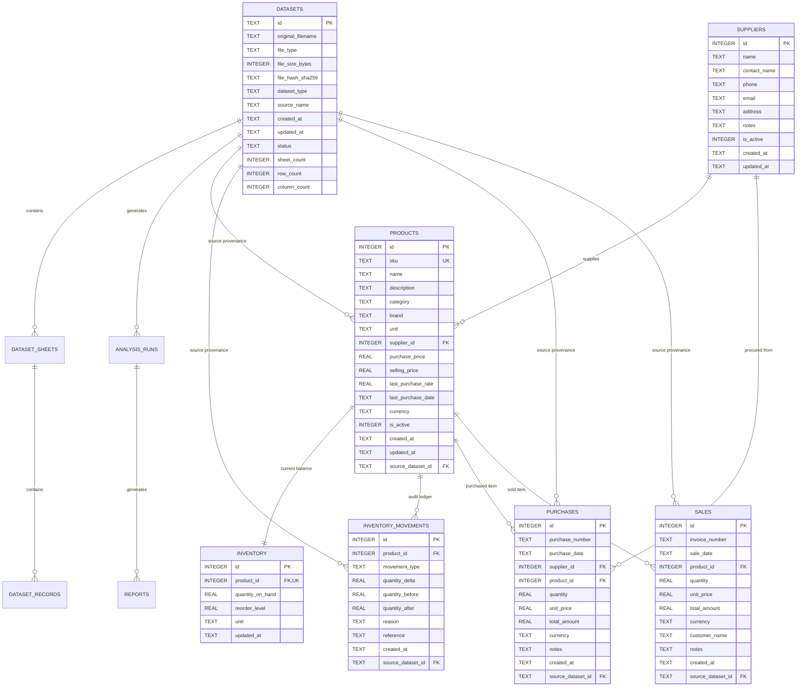

# VANTIQ Business Data Model (V3)
**Architecture, Schema Specification, Pricing & Inventory Semantics, Provenance, and Operations**

---

## 1. Executive Summary

This document specifies the finalized, production-grade SQLite business data model for the **VANTIQ AI-Powered Business Intelligence Assistant** (Schema Version 3).

The business data model unifies:
1. **Raw Dataset Archival & Staging**: Full SHA-256 deduplicated persistence of Excel worksheets, rows, analysis runs, and BI reports.
2. **Normalized Business Catalogue**: Internal product identifiers, partial unique SKU indexes, hierarchical categorization, supplier assignments, and base pricing.
3. **Dual Pricing Semantics**: Strict separation between baseline catalog acquisition cost, active selling list price, and latest procurement invoice rates (`last_purchase_rate`, `last_purchase_date`).
4. **Perpetual Inventory & Movement Ledger**: Real-time stock balance tracking backed by an immutable ledger of all stock additions, deductions, adjustments, receipts, and sales.
5. **Procurement & Sales Transaction Ledgers**: Structured tracking of supplier purchase orders and customer sales with full dataset provenance.
6. **Strict Data Integrity**: Forced `PRAGMA foreign_keys = ON`, `PRAGMA journal_mode = WAL`, check constraints, decimal-safe rounding, and atomic transactions.

---

## 2. Actual Implemented Schema & Entity-Relationship Diagram



---

## 3. Database Tables & Field Specification

### 3.1 `schema_migrations`
Tracks versioned migration history.
- `version` (INTEGER, PK): Monotonically increasing schema version number.
- `applied_at` (TEXT, NOT NULL): UTC ISO-8601 timestamp when migration completed.

### 3.2 `datasets`
Raw imported dataset files (Excel / CSV / PDF).
- `id` (TEXT, PK): Unique UUID identifying the dataset.
- `original_filename` (TEXT, NOT NULL): Original name of uploaded file.
- `file_type` (TEXT, NOT NULL): Extension or MIME type (`xlsx`, `csv`, `pdf`).
- `file_size_bytes` (INTEGER, NOT NULL): File size in bytes.
- `file_hash_sha256` (TEXT, NOT NULL): Cryptographic SHA-256 hash preventing duplicate storage.
- `dataset_type` (TEXT, NOT NULL): Category (`sales`, `inventory`, `catalogue`, `mixed`).
- `created_at`, `updated_at` (TEXT, NOT NULL): UTC ISO-8601 timestamps.
- `status` (TEXT, NOT NULL DEFAULT 'active'): Operational status (`active`, `archived`, `deleted`).

### 3.3 `dataset_sheets` & `dataset_records`
Structured storage of raw spreadsheet worksheets and rows.
- `dataset_sheets.dataset_id` (TEXT, FK -> `datasets.id` ON DELETE CASCADE)
- `dataset_records.sheet_id` (TEXT, FK -> `dataset_sheets.id` ON DELETE CASCADE)
- `dataset_records.record_json` (TEXT, NOT NULL): JSON-serialized row dictionary.

### 3.4 `suppliers`
Registered business vendors and procurement partners.
- `id` (INTEGER, PK AUTOINCREMENT): Internal supplier ID.
- `name` (TEXT, NOT NULL): Official trading or legal name.
- `contact_name` (TEXT): Primary contact representative.
- `phone`, `email`, `address`, `notes` (TEXT): Contact details.
- `is_active` (INTEGER, NOT NULL DEFAULT 1): Active status flag.

### 3.5 `products`
The central catalog of sellable and stockable items.
- `id` (INTEGER, PK AUTOINCREMENT): Stable internal product ID.
- `sku` (TEXT): Stock Keeping Unit or barcode. Indexed with partial unique index `idx_products_sku_unique` on non-null, non-empty values.
- `name` (TEXT, NOT NULL): Display name of product.
- `description`, `category`, `brand` (TEXT): Metadata attributes.
- `unit` (TEXT, DEFAULT 'piece'): Unit of measurement (`piece`, `kg`, `liter`, `box`, `meter`).
- `supplier_id` (INTEGER, FK -> `suppliers.id` ON DELETE SET NULL): Primary vendor.
- `purchase_price` (REAL, DEFAULT 0.0 CHECK(purchase_price >= 0)): Catalog standard acquisition cost.
- `selling_price` (REAL, DEFAULT 0.0 CHECK(selling_price >= 0)): Active retail list price.
- `last_purchase_rate` (REAL, CHECK(last_purchase_rate IS NULL OR last_purchase_rate >= 0)): Rate from most recent procurement invoice.
- `last_purchase_date` (TEXT): Date of most recent purchase invoice.
- `currency` (TEXT, DEFAULT 'INR'): Monetary currency code.
- `is_active` (INTEGER, NOT NULL DEFAULT 1): Soft-delete flag (never hard-delete historical products).
- `source_dataset_id` (TEXT, FK -> `datasets.id` ON DELETE SET NULL): Provenance link to spreadsheet where item originated.

### 3.6 `inventory`
Current operational stock levels per product.
- `id` (INTEGER, PK AUTOINCREMENT)
- `product_id` (INTEGER, NOT NULL UNIQUE, FK -> `products.id` ON DELETE CASCADE): 1-to-1 relationship with `products`.
- `quantity_on_hand` (REAL, NOT NULL DEFAULT 0.0 CHECK(quantity_on_hand >= 0)): Actual available units.
- `reorder_level` (REAL, NOT NULL DEFAULT 0.0 CHECK(reorder_level >= 0)): Minimum safety threshold.
- `unit` (TEXT): Inherited stock unit.
- `updated_at` (TEXT, NOT NULL): UTC ISO-8601 timestamp.

### 3.7 `inventory_movements`
Immutable audit log of all stock changes.
- `id` (INTEGER, PK AUTOINCREMENT)
- `product_id` (INTEGER, NOT NULL, FK -> `products.id` ON DELETE CASCADE)
- `movement_type` (TEXT, NOT NULL): `opening_balance`, `receipt`, `sale`, `adjustment`, `return`.
- `quantity_delta` (REAL, NOT NULL): Signed quantity (+ for additions, - for deductions).
- `quantity_before`, `quantity_after` (REAL, NOT NULL): Snapshot of balance before and after operation.
- `reason` (TEXT, NOT NULL): Descriptive reason or user comment.
- `reference` (TEXT): Purchase Order ID, Sales Invoice ID, or Import Batch ID.
- `created_at` (TEXT, NOT NULL): UTC ISO-8601 timestamp.
- `source_dataset_id` (TEXT, FK -> `datasets.id` ON DELETE SET NULL)

### 3.8 `purchases`
Procurement transaction ledger.
- `id` (INTEGER, PK AUTOINCREMENT)
- `purchase_number` (TEXT): Vendor invoice or internal PO number.
- `purchase_date` (TEXT, NOT NULL): ISO date (`YYYY-MM-DD`).
- `supplier_id` (INTEGER, FK -> `suppliers.id` ON DELETE SET NULL)
- `product_id` (INTEGER, NOT NULL, FK -> `products.id` ON DELETE CASCADE)
- `quantity` (REAL, NOT NULL CHECK(quantity > 0)): Units purchased.
- `unit_price` (REAL, NOT NULL CHECK(unit_price >= 0)): Invoice rate per unit.
- `total_amount` (REAL, NOT NULL CHECK(total_amount >= 0)): Total transaction value (`round(quantity * unit_price, 2)`).
- `currency` (TEXT, DEFAULT 'INR')
- `notes` (TEXT)
- `source_dataset_id` (TEXT, FK -> `datasets.id` ON DELETE SET NULL)

### 3.9 `sales`
Customer order transaction ledger.
- `id` (INTEGER, PK AUTOINCREMENT)
- `invoice_number` (TEXT): Customer invoice or sales slip ID.
- `sale_date` (TEXT, NOT NULL): ISO date (`YYYY-MM-DD`).
- `product_id` (INTEGER, NOT NULL, FK -> `products.id` ON DELETE CASCADE)
- `quantity` (REAL, NOT NULL CHECK(quantity > 0)): Units sold.
- `unit_price` (REAL, NOT NULL CHECK(unit_price >= 0)): Unit selling price charged.
- `total_amount` (REAL, NOT NULL CHECK(total_amount >= 0)): Total sale value (`round(quantity * unit_price, 2)`).
- `currency` (TEXT, DEFAULT 'INR')
- `customer_name` (TEXT)
- `notes` (TEXT)
- `source_dataset_id` (TEXT, FK -> `datasets.id` ON DELETE SET NULL)

---

## 4. Pricing Semantics

1. **Catalog Purchase Price (`products.purchase_price`)**:
   - Represents the catalog reference or standard acquisition cost.
   - Used for provisional inventory valuation and baseline margin calculations.
   - It is NOT overwritten when individual purchase orders fluctuate, preserving stable baseline profitability metrics.

2. **Last Purchase Rate (`products.last_purchase_rate` & `last_purchase_date`)**:
   - Updated automatically when a procurement purchase order is recorded via `record_purchase(..., update_last_purchase_rate=True)`.
   - Captures real-world price changes, inflation, or seasonal vendor rate shifts.
   - Provides actual effective replacement costing for business analytics.

3. **Active Selling Price (`products.selling_price`)**:
   - The active retail list price.
   - Required for calculating gross profit and margin percentages.

4. **Monetary Precision & Decimal Safety**:
   - All monetary calculations round strictly to 2 decimal places using `round(float(...), 2)` or `decimal.Decimal`.
   - Multiplications (`quantity * unit_price`) and profit calculations (`selling_price - purchase_price`) are explicitly rounded before persistence.

5. **Margin Formulas**:
   $$\text{Unit Gross Profit} = \text{Selling Price} - \text{Purchase Cost}$$
   $$\text{Gross Margin \%} = \left(\frac{\text{Selling Price} - \text{Purchase Cost}}{\text{Selling Price}}\right) \times 100$$
   $$\text{Markup \%} = \left(\frac{\text{Selling Price} - \text{Purchase Cost}}{\text{Purchase Cost}}\right) \times 100$$

---

## 5. Inventory Semantics

1. **Balance Representation**:
   - Current stock on hand is maintained in `inventory.quantity_on_hand`.
   - Every product has exactly one associated inventory record (`product_id UNIQUE`).

2. **Immutable Movement Ledger**:
   - Direct manual edits to `inventory.quantity_on_hand` are strictly forbidden.
   - All balance changes require a corresponding row in `inventory_movements` with `movement_type`, signed `quantity_delta`, `quantity_before`, and `quantity_after`.

3. **Supported Movement Types**:
   - `opening_balance`: Initial stock upon product creation or spreadsheet import.
   - `receipt`: Stock received from a supplier purchase order (`record_purchase`).
   - `sale`: Stock deducted to fulfill a customer sale (`record_sale`).
   - `adjustment`: Stock take corrections, shrinkage, or audit reconciliations (`record_inventory_movement`).
   - `return`: Customer return (stock increase) or supplier return (stock decrease).

4. **Stock Validation & Protection**:
   - Sales are rejected if `quantity > quantity_on_hand`, preventing accidental negative stock balances.
   - Database check constraint `CHECK(quantity_on_hand >= 0)` enforces non-negative physical stock at the SQLite engine level.

---

## 6. Import-to-Business-Record Flow & Provenance

```
Raw Spreadsheet / PDF Upload
           │
           ▼
[1] SHA-256 Hash Deduplication Check
    ├── If duplicate found -> Reuses existing dataset record
    └── If new -> Transactionally saved in `datasets`, `dataset_sheets`, `dataset_records`
           │
           ▼
[2] Header Analysis & Column Mapping Engine
    └── Auto-detects SKU, Name, Category, Prices, Opening Stock, Supplier
           │
           ▼
[3] Import Preview & Validation Service
    ├── Valid rows: Clean, typed data ready for ingestion
    ├── Duplicate rows: Matched against existing SKU or exact Name
    └── Invalid rows: Missing mandatory names, invalid numeric prices, or negative stock
           │
           ▼
[4] User-Selected Deduplication Strategy
    ├── 'skip_existing': Preserves existing products without changes
    └── 'update_permitted_fields': Updates category, brand, supplier without overwriting active stock or prices
           │
           ▼
[5] Normalized Persistence
    ├── Products saved in `products` with `source_dataset_id`
    ├── Stock initialized in `inventory`
    └── Opening balance movement written to `inventory_movements` with `source_dataset_id`
```

---

## 7. Migration & Backup Instructions

### 7.1 Automated Backup
Before any schema migration or critical maintenance, create a verified online backup using SQLite's native backup API:
```python
import database
backup_path = database.create_backup(backup_name="pre_migration_backup")
```

### 7.2 Running Migrations
Migrations are managed in `database.py` via `init_db()` and tracked in `schema_migrations`:
```bash
python -c "import database; database.init_db()"
```
- Migration V1: Core dataset staging, sheets, records, analysis runs, reports.
- Migration V2: Suppliers, products, inventory balances, inventory movements.
- Migration V3: Purchases ledger, sales ledger, last purchase rate/date, partial unique index on SKU.

---

## 8. Business Rules & Unresolved Client Decisions

The following items are intentionally preserved as documented business rules requiring client confirmation rather than assumed:

1. **Inventory Costing Valuation Method**:
   - The system tracks standard catalog cost, actual purchase invoice rates, and movement snapshots.
   - *Client Decision Needed*: Whether official financial statements should compute inventory valuation via **FIFO** (First-In, First-Out), **Weighted Average Cost**, or **Last Purchase Price**.
2. **Tax Treatment (GST/VAT)**:
   - Current prices and transaction amounts are stored as raw currency numbers.
   - *Client Decision Needed*: Clarify whether entered prices are tax-inclusive or tax-exclusive, and whether tax rates (e.g., 5%, 12%, 18%) should be stored per product or calculated dynamically.
3. **Discount & Promotion Policy**:
   - Sales transactions record effective `unit_price` charged.
   - *Client Decision Needed*: Whether explicit discount percentage or promotional code fields are required on individual sales line items.
